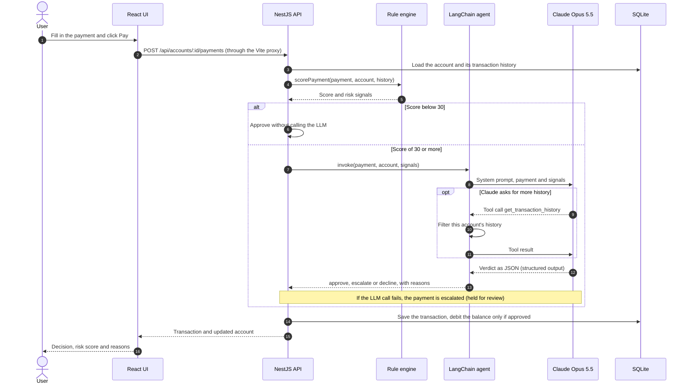

# Fullstack Fraud Detector Langchain

> [!IMPORTANT]
> **Disclaimer:** this is a didactic project. Its main purpose is to exercise the use and understanding of LangChain. It is not meant to be a production-ready application.
>
> Improvements that I deliberately ignored:
>
> - Synchronous requests (the LLM fraud review runs inside the HTTP request, with no queue)
> - Authentication
> - Domain level custom exceptions
> - Timezone support
> - Full project test coverage
> - Production setup
> - Hardening configurations
> - External storage for rate limit (counters are kept in memory)
> - HTTP client layer for frontend
> - Any other best practice for a modern fullstack web application
>
> **Why the model used here is not recommended for production:** the fraud review uses Claude Opus 5.5, a general-purpose LLM. Neither it nor any similar model is a good fit for real-time fraud decisions:
>
> - **Not specialized:** it isn't trained on fraud patterns or on your own transaction data. Production systems use dedicated models (for example gradient-boosted trees or graph models) trained on labeled fraud and chargeback history.
> - **Slow:** each review here takes about 6 to 10 seconds (two model calls plus reasoning). Card authorization usually has to answer in well under a second.
> - **Expensive at scale:** about $0.017 per review in this project (around 2,900 input and 300 output tokens). Millions of payments a day would cost thousands of dollars a day, where a traditional model costs a fraction of a cent per decision.
> - **Non-deterministic:** the same payment can get a different decision or risk score on another run, which makes results hard to reproduce, test and audit.
> - **Uncalibrated scores:** the risk score is the model's opinion, not a measured probability, so thresholds can't be tuned against real fraud rates.
> - **Explanations aren't guaranteed to be faithful:** the reasons are generated text that sounds plausible, not a trace of how the decision was made.
> - **Attack surface:** customer-controlled text, like the merchant name, goes into the prompt. Fraudsters can attempt prompt injection, or probe the model to learn what gets through.
> - **Doesn't learn from outcomes:** confirmed fraud and chargebacks don't feed back into it, while traditional models are retrained on them.
> - **External dependency:** outages, rate limits, latency spikes and safety refusals at the provider directly affect payments.
> - **Data privacy:** customers' financial history is sent to a third-party API, which raises data protection and residency questions (LGPD, GDPR).
> - **Behavior can change:** providers update and retire models, so decisions can shift and the system needs to be re-validated each time.
>
> I just want to explore the use of LangChain.

## Table of contents

- [Demo](#demo)
- [Prerequisites](#prerequisites)
- [Getting started](#getting-started)
- [Configuration](#configuration)
- [How it works](#how-it-works)
  - [Payment flow](#payment-flow)
  - [Fraud rules](#fraud-rules)
- [LangChain concepts used](#langchain-concepts-used)
- [Lessons learned](#lessons-learned)
- [Rate limiting](#rate-limiting)
- [API reference](#api-reference)
- [Project structure](#project-structure)
- [Tech stack](#tech-stack)
- [Tests](#tests)
- [Ideas to explore next](#ideas-to-explore-next)
- [References](#references)

## Demo


An everyday purchase is approved by the rules alone. A gift card purchase abroad that spends most of a fresh top-up is sent to Claude, which declines it and explains why. [Full-quality video (MP4)](docs/demo.mp4).

## Prerequisites

- **Node.js 24.**
- **An Anthropic API key** for the LLM review. Without one the app still runs, but every payment the rules flag is held for manual review instead of being reviewed by Claude.
- **Free ports 3001 and 5173**, or other ports set through [Configuration](#configuration).

## Getting started

```bash
# terminal 1: API on http://localhost:3001
nvm use
cd backend && npm install && npm run start:dev

# terminal 2: UI on http://localhost:5173 (proxies /api to the backend)
nvm use
cd frontend && npm install && npm run dev
```

Put your key in `backend/.env` or in a `.env` at the repo root (`ANTHROPIC_API_KEY=...`), then open http://localhost:5173.

## Configuration

The backend reads environment variables from `backend/.env`, or from `.env` at the repo root if `backend/.env` doesn't exist. `backend/.env.example` lists them all.

| Variable | Default | Description |
|---|---|---|
| `ANTHROPIC_API_KEY` | none | Claude API key. Without it, flagged payments are held for review. |
| `FRAUD_MODEL` | `claude-opus-5-5` | Claude model used for the fraud review. |
| `DATABASE_PATH` | `fraud-demo.sqlite` | SQLite file, relative to the folder the backend runs from (`backend/`). |
| `PORT` | `3001` | API port. |
| `RATE_LIMIT_PER_DAY` | `1000` | Requests allowed per client IP every 24 hours. |

The frontend dev server reads one variable from its environment:

| Variable | Default | Description |
|---|---|---|
| `BACKEND_URL` | `http://localhost:3001` | Where Vite forwards `/api` requests. |

If you set `FRAUD_MODEL` to a model without server-side refusal fallback, such as Claude Haiku 5.5, also remove `betas` and `invocationKwargs` from `backend/src/fraud/fraud.module.ts`.

## How it works

How a payment is checked (`backend/src/payments/payments.service.ts`):

1. `fraud.rules.ts` scores the payment against the account's history: new account, foreign country, high-risk category, amount spikes, velocity, card testing, draining fresh credits, recent blocks.
2. Below 30 points the rules approve it on their own.
3. Otherwise `fraud.service.ts` runs a LangChain agent (`createAgent`, Claude Opus 5.5) with a `get_transaction_history` tool scoped to that account. It returns `approve` / `escalate` / `decline` with reasons, via structured output.
4. Only approved payments are debited. Escalated (`review`) and declined payments are recorded but don't move money. If the LLM call fails, the payment is held for review rather than approved.

### Payment flow



### Fraud rules

`backend/src/fraud/fraud.rules.ts` gives every payment points for each signal below. The total is capped at 100. Below 30 the payment is approved without calling the LLM; at 30 or more it goes to Claude.

| Signal | Points | When it fires |
|---|---:|---|
| `NEW_ACCOUNT` | 10 | The account was created less than 24 hours ago. |
| `FOREIGN_COUNTRY` | 15 | The payment country differs from the account's home country. |
| `HIGH_RISK_CATEGORY` | 20 | The category is `gift_cards`, `crypto` or `wire_transfer`. |
| `AMOUNT_SPIKE` | 25 | The account has at least 3 approved payments, and this one is more than 5 times their average. |
| `VELOCITY` | 20 | The account made 3 or more payments in the last 10 minutes. |
| `CARD_TESTING` | 25 | The account made 2 or more payments of $1 or less in the last hour. |
| `DRAINS_NEW_CREDIT` | 20 | Credits were added in the last 30 minutes, and the payment is at least 80% of the balance. |
| `RECENTLY_BLOCKED` | 20 | A payment was declined or held in the last 24 hours. |

For example, the suspicious purchase in the demo scores 65: a new account (10) buying gift cards (20) in another country (15) right after a top-up (20).

## LangChain concepts used

| Concept | Where | What it does here |
|---|---|---|
| `ChatAnthropic` | `backend/src/fraud/fraud.module.ts` | The Claude chat model from `@langchain/anthropic`. A factory creates it for each review, so a missing API key fails that review instead of the server's startup. `betas` and `invocationKwargs` pass API options that LangChain has no named setting for, here Claude's server-side refusal fallback. |
| `createAgent` | `backend/src/fraud/fraud.service.ts` | Builds the agent loop: call the model, run any tool it asks for, send the result back, and repeat until it answers. It runs with `agent.invoke({ messages })`. |
| `tool()` with a zod schema | `transactionHistoryTool` in `fraud.service.ts` | `get_transaction_history` lets Claude filter the account's history by type and time. It only sees the history of the account under review and takes no account id, so a prompt injection can't make it read other customers' data. |
| `providerStrategy` | `fraud.service.ts` | Structured output through Claude's native JSON schema support. The agent returns the parsed verdict in `structuredResponse`, typed from the zod schema `FraudVerdict`. |
| `systemPrompt` | `fraud.service.ts` | The analyst instructions, including treating everything inside `<payment>` as untrusted data. |
| A custom `BaseChatModel` | `backend/test/scripted-chat-model.ts` | `ScriptedChatModel` replays a fixed list of messages (a tool call, then a verdict), so tests run the real agent without calling Claude. The e2e tests swap it in with Nest's `overrideProvider(FRAUD_MODEL)`. |

## Lessons learned

Things that didn't work the first time, and why:

1. **`toolStrategy` fails on Claude Opus 5.5.** It gets structured output by forcing the model to call a tool (`tool_choice: "any"`), which Opus 5.5 rejects with a 400 error. `providerStrategy` uses the API's native structured output instead.
2. **Structured output rejects number limits.** Claude's structured outputs rejected `minimum` and `maximum` on the integer risk score, and zod 4's `.int()` adds both silently (the safe-integer range). The schema uses a plain `z.number()`, and the code rounds and clamps the score to 0–100.
3. **`ChatAnthropic` throws without an API key.** Its constructor fails when `ANTHROPIC_API_KEY` is missing, so the model is created inside the review. The error is caught there, and the payment is held for review instead of the server failing to start.
4. **Use `fakeModel()` to test agents.** The fakes in `@langchain/core/utils/testing` either return text only (`FakeListChatModel`) or the same reply every time (`FakeStreamingChatModel`), so this project wrote its own `ScriptedChatModel`. `fakeModel()` from `@langchain/core/testing` already does this: `.respondWithTools()` and `.respond()` queue one reply per model call.

## Rate limiting

- Every endpoint shares one budget of 1,000 requests per client IP per 24 hours (`RATE_LIMIT_PER_DAY`), using `@nestjs/throttler` in `backend/src/app.module.ts`.
- The window slides: each request counts for 24 hours after it was made.
- Request 1,001 blocks the IP for 24 hours from that moment. After that, its count starts again from zero.
- Over the limit, the API answers `429` with a `Retry-After` header. Every response carries `X-RateLimit-Limit`, `X-RateLimit-Remaining` and `X-RateLimit-Reset`.

## API reference

The API runs on `http://localhost:3001`. The UI calls the same routes under `/api`, through the Vite proxy. Amounts are integer cents.

| Method | Path | Body | Success |
|---|---|---|---|
| `POST` | `/accounts` | `{ name, country }` | `201`, the new account |
| `GET` | `/accounts` | | `200`, all accounts, newest first |
| `GET` | `/accounts/:id` | | `200`, the account |
| `POST` | `/accounts/:id/credits` | `{ amountCents }` | `201`, the updated account |
| `GET` | `/accounts/:id/transactions` | | `200`, the account's transactions, newest first |
| `POST` | `/accounts/:id/payments` | `{ amountCents, merchant, category, country }` | `201`, `{ transaction, account }` |

Validation rules:

- `name`: not empty, up to 100 characters. `country`: an ISO 3166-1 alpha-2 code such as `BR` or `US`.
- `amountCents`: a positive integer. Credits are capped at 100,000,000 cents ($1,000,000) per request.
- `merchant`: not empty, up to 100 characters. `category`: one of `groceries`, `restaurants`, `fuel`, `electronics`, `travel`, `gaming`, `streaming`, `gift_cards`, `crypto`, `wire_transfer`.
- Fields not listed here are rejected.

Errors:

| Status | When | Example body |
|---|---|---|
| `400` | Invalid input, or a payment the balance can't cover | `{"message":"Insufficient balance","error":"Bad Request","statusCode":400}` |
| `404` | Unknown account | `{"message":"Account 999 not found","error":"Not Found","statusCode":404}` |
| `429` | Daily rate limit reached | `{"statusCode":429,"message":"Daily request limit reached for your IP address. Try again tomorrow."}` |

Examples:

```bash
# Create an account
curl -X POST http://localhost:3001/accounts \
  -H 'Content-Type: application/json' \
  -d '{"name":"Ana Souza","country":"BR"}'
```

```json
{ "id": 1, "name": "Ana Souza", "country": "BR", "balanceCents": 0, "createdAt": "2026-10-11T14:19:06.705Z" }
```

```bash
# Add $500.00 of mock credits
curl -X POST http://localhost:3001/accounts/1/credits \
  -H 'Content-Type: application/json' \
  -d '{"amountCents":50000}'
```

```json
{ "id": 1, "name": "Ana Souza", "country": "BR", "balanceCents": 50000, "createdAt": "2026-10-11T14:19:06.705Z" }
```

```bash
# An everyday payment: scores 10, approved by the rules
curl -X POST http://localhost:3001/accounts/1/payments \
  -H 'Content-Type: application/json' \
  -d '{"amountCents":4250,"merchant":"Whole Foods","category":"groceries","country":"BR"}'
```

```json
{
  "transaction": {
    "id": 2, "accountId": 1, "type": "payment", "amountCents": 4250,
    "merchant": "Whole Foods", "category": "groceries", "country": "BR",
    "status": "approved", "riskScore": 10,
    "fraudReasons": ["Account was created less than a day ago"],
    "reviewedBy": "rules", "createdAt": "2026-10-11T14:19:06.735Z"
  },
  "account": { "id": 1, "name": "Ana Souza", "country": "BR", "balanceCents": 45750, "createdAt": "2026-10-11T14:19:06.705Z" }
}
```

```bash
# A suspicious payment: scores 65, reviewed and declined by Claude
curl -X POST http://localhost:3001/accounts/1/payments \
  -H 'Content-Type: application/json' \
  -d '{"amountCents":41000,"merchant":"GiftCardMall","category":"gift_cards","country":"NG"}'
```

Claude's reasons differ between runs; they're shortened here. The balance doesn't change, because the payment was declined.

```json
{
  "transaction": {
    "id": 3, "accountId": 1, "type": "payment", "amountCents": 41000,
    "merchant": "GiftCardMall", "category": "gift_cards", "country": "NG",
    "status": "declined", "riskScore": 90,
    "fraudReasons": [
      "This gift card purchase would spend about 90% of the balance right after the credit was added.",
      "Gift cards are a high-risk category because they are easy to cash out.",
      "The payment is in NG, but the account is based in BR."
    ],
    "reviewedBy": "llm", "createdAt": "2026-10-11T14:19:15.102Z"
  },
  "account": { "id": 1, "name": "Ana Souza", "country": "BR", "balanceCents": 45750, "createdAt": "2026-10-11T14:19:06.705Z" }
}
```

```bash
# The account's history, newest first
curl http://localhost:3001/accounts/1/transactions
```

## Project structure

```text
.
├── backend/                         NestJS API
│   ├── src/
│   │   ├── main.ts                  Startup, .env loading, port
│   │   ├── app.module.ts            Modules, input validation, rate limiter
│   │   ├── app.setup.ts             Trust proxy setting
│   │   ├── database/                node:sqlite connection, schema, transaction helper
│   │   ├── accounts/                Accounts, credits, transaction history
│   │   ├── payments/                Payment endpoint: fraud check, then debit
│   │   └── fraud/
│   │       ├── fraud.rules.ts       Rule engine (no LLM)
│   │       ├── fraud.service.ts     LangChain agent, tool and structured output
│   │       └── fraud.module.ts      ChatAnthropic configuration
│   └── test/                        E2E tests and the scripted fake model
├── frontend/                        React app (Vite)
│   └── src/
│       ├── App.tsx                  Page layout
│       ├── Disclaimer.tsx           Project disclaimer
│       ├── AccountPicker.tsx        Create or open an account
│       ├── AccountDashboard.tsx     Balance, credits, payments and history
│       ├── PaymentForm.tsx          Payment form and fraud check result
│       ├── TransactionList.tsx      History table
│       └── api.ts                   API types and fetch calls
├── docs/                            Demo GIF and video
└── .nvmrc                           Node 24
```

## Tech stack

| Layer | Technology |
|---|---|
| LLM | `langchain` 1.5.16, `@langchain/core` 1.2.17, `@langchain/anthropic` 1.5.12, Claude Opus 5.5, zod 4.6 |
| Backend | NestJS 12.1, `node:sqlite` (Node 24), class-validator 0.15, `@nestjs/throttler` 6.7 |
| Frontend | React 19.3, Vite 8.3 |
| Tests | Vitest (4.1 in the backend, 5.0 in the frontend), Supertest, Testing Library, jsdom |
| Language | TypeScript 6.0 |

## Tests

Run `npm test` in either folder.

- **Backend:** unit tests for the fraud rules and the fraud service, plus e2e HTTP tests for accounts, payments and rate limiting.
- **Frontend:** component tests with a mocked `fetch`.

LLM calls are replaced by a scripted fake model, so tests never call Claude.

## Ideas to explore next

LangChain features this project doesn't use yet:

- **Prompt caching** with `anthropicPromptCachingMiddleware`. The system prompt and tool definitions are the same on every review, and cached input is cheaper and doesn't count toward Claude's input-token rate limit.
- **Retries and fallbacks** with `modelRetryMiddleware` and `modelFallbackMiddleware`, for example switching to another model when Claude is rate-limited.
- **Human approval** with `humanInTheLoopMiddleware`. An action tool such as `block_card` could pause the agent until an analyst approves it.
- **Tracing** with LangSmith, to see every model call, tool call and token count of a review.
- **Evaluation**: a set of transactions with known outcomes, to measure how often the agent decides correctly before changing the prompt, the model or its effort setting.
- **`fakeModel()` in the tests**, replacing the custom `ScriptedChatModel` (see [Lessons learned](#lessons-learned)).

## References

LangChain:

- [LangChain JS overview](https://docs.langchain.com/oss/javascript/langchain/overview)
- [Agents](https://docs.langchain.com/oss/javascript/langchain/agents)
- [Tools](https://docs.langchain.com/oss/javascript/langchain/tools)
- [Structured output](https://docs.langchain.com/oss/javascript/langchain/structured-output)
- [Middleware](https://docs.langchain.com/oss/javascript/langchain/middleware) and [built-in middleware](https://docs.langchain.com/oss/javascript/langchain/middleware/built-in)
- [ChatAnthropic integration](https://docs.langchain.com/oss/javascript/integrations/chat/anthropic)
- [Testing](https://docs.langchain.com/oss/javascript/langchain/test)
- [Observability](https://docs.langchain.com/oss/javascript/langchain/observability) and [LangSmith](https://docs.langchain.com/langsmith/home)

Claude:

- [Models overview](https://platform.claude.com/docs/en/about-claude/models/overview)
- [Structured outputs](https://platform.claude.com/docs/en/build-with-claude/structured-outputs)
- [Prompt caching](https://platform.claude.com/docs/en/build-with-claude/prompt-caching)
- [Rate limits](https://platform.claude.com/docs/en/api/rate-limits)

Stack:

- [NestJS rate limiting](https://docs.nestjs.com/security/rate-limiting)
- [Express behind proxies](https://expressjs.com/en/guide/behind-proxies.html)
- [Node.js SQLite](https://nodejs.org/api/sqlite.html)
- [Vite server options](https://vite.dev/config/server-options)
